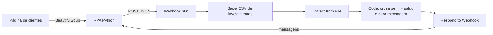
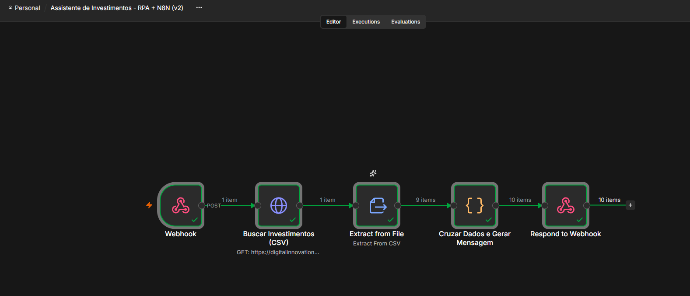

# 🤖 Assistente de Investimentos com RPA + n8n


MVP que extrai clientes de uma página web com **RPA em Python**, cruza o perfil e o saldo de cada um com uma base de investimentos em um **workflow n8n** e devolve uma **recomendação personalizada** por cliente.

> Entrega do desafio **"Criando um Assistente de Investimentos com RPA e IA Generativa"** — DIO.
> Os dados de clientes são **fictícios**, fornecidos pelo próprio desafio.

---

## 🎯 Problema

Um assessor precisa recomendar produtos adequados a dezenas de clientes, cada um com perfil de risco e saldo diferentes. Fazer isso manualmente é lento e sujeito a erro — por exemplo, sugerir um produto cujo valor mínimo o cliente não tem.

## 💡 Solução



1. **RPA (Python)** — `rpa/extrair_clientes.py` lê a tabela de clientes e envia os 10 registros em JSON ao webhook do n8n.
2. **Webhook (n8n)** — recebe `{"clientes": [...]}` via POST.
3. **Buscar Investimentos** — HTTP Request baixa o `data.csv` com as opções por perfil.
4. **Extract from File** — converte o CSV em itens.
5. **Cruzar Dados e Gerar Mensagem (Code)** — para cada cliente, filtra os produtos do mesmo perfil **cujo valor mínimo cabe no saldo** e monta a mensagem.
6. **Respond to Webhook** — devolve as mensagens ao script, que as imprime no terminal.

## 🧠 Decisões técnicas

| Decisão | Por quê |
|---|---|
| Filtro por **perfil + saldo** (`minimo <= saldo`) | Evita recomendação inviável — ex.: cliente com R$ 500 não recebe CDB de mínimo R$ 1.000 |
| Conversão de moeda (`"R$ 12.500,00"` → `12500`) | O saldo chega como texto; precisa ser número para comparar |
| **Respond to Webhook** | O script recebe exatamente a lista de mensagens geradas, de forma síncrona |
| URL do webhook via **variável de ambiente** | Nenhuma URL ou segredo fica fixo no código |
| n8n **self-hosted** em `localhost:5678` | Execução local; por isso o script roda na máquina (o Colab não alcança localhost) |

## ✅ Resultado

Workflow executado de ponta a ponta (5 nós):



Mensagens personalizadas devolvidas ao terminal:


## ▶️ Como executar

```bash
# 1. Instale as dependências
pip install -r requirements.txt

# 2. (Opcional) configure a URL do webhook
cp .env.example .env        # ajuste N8N_WEBHOOK_URL se necessário

# 3. No n8n: importe n8n/workflow.json e clique em "Execute workflow"

# 4. Rode o RPA
python rpa/extrair_clientes.py
```

## 📁 Estrutura

```
├── rpa/extrair_clientes.py   # extração (BeautifulSoup) + envio ao n8n
├── n8n/workflow.json         # workflow exportado, sem credenciais
├── docs/                     # página de clientes, CSV de investimentos e prints
├── requirements.txt
└── .env.example
```

## 🚀 Próximos passos

- [ ] Trocar os templates estáticos por geração de texto com LLM (IA generativa)
- [ ] Enviar as recomendações por e-mail em vez de imprimir no terminal
- [ ] Testes automatizados para a conversão de moeda e o filtro por saldo

---

**Autor:** Felipe Kimura · [LinkedIn](https://linkedin.com/in/felipe-kimura)
