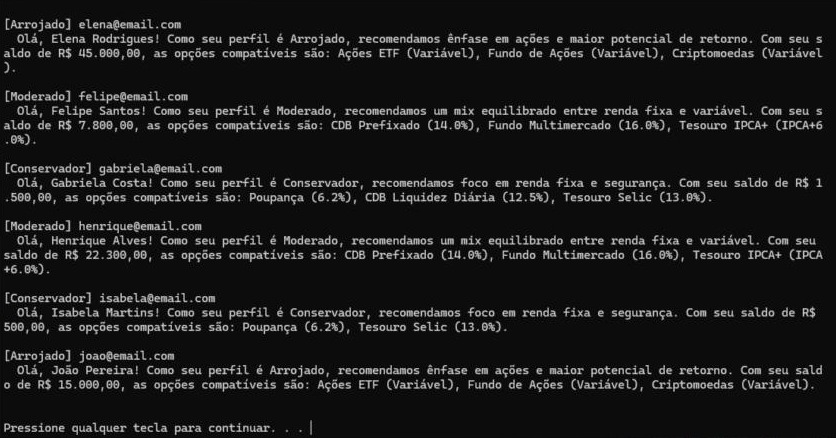

# Assistente de Investimentos com RPA + N8N

Entrega do desafio DIO **Criando um Assistente de Investimentos com RPA e IA Generativa** (MVP com mensagens estáticas).

## Como funciona

1. **RPA (Python)** – `rpa/extrair_clientes.py` acessa a página de clientes (GitHub Pages), lê a tabela com BeautifulSoup e envia os 10 clientes em JSON para o Webhook do N8N.
2. **Webhook (N8N)** – recebe `{"clientes": [...]}` via POST.
3. **Buscar Investimentos (CSV)** – HTTP Request baixa o `data.csv` com as opções por perfil.
4. **Extract from File** – converte o CSV em itens.
5. **Cruzar Dados e Gerar Mensagem (Code)** – para cada cliente, filtra os produtos do mesmo perfil **cujo valor mínimo cabe no saldo** e monta a mensagem com o template do perfil.
6. **Respond to Webhook** – devolve as mensagens ao script, que as imprime no terminal.

## Decisões técnicas

- **Filtro por saldo**: além do perfil, só recomendo produtos com `minimo <= saldo` (ex.: Isabela, R$ 500, não recebe CDB de R$ 1.000).
- **Conversão de moeda**: o saldo chega como texto ("R$ 12.500,00") e é convertido para número antes da comparação.
- **Respond to Webhook**: garante que o script receba exatamente a lista de mensagens geradas.
- **Execução local**: N8N self-hosted em `localhost:5678`; por isso o script roda na máquina local (o Colab não alcança localhost).

## Templates (MVP)

| Perfil | Foco |
|---|---|
| Conservador | renda fixa e segurança |
| Moderado | mix entre renda fixa e variável |
| Arrojado | ações e maior potencial de retorno |

## Como executar

1. `pip install requests beautifulsoup4`
2. Importe `n8n/workflow.json` no N8N, clique em **Execute workflow** (ou ative para usar a URL de produção).
3. `python rpa/extrair_clientes.py`

## Evidência

